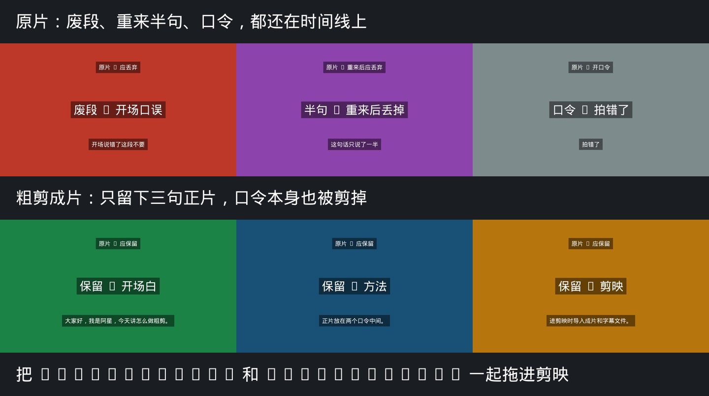

# 口播不用一条条删了：喊两句口令，粗剪自己出来

拍口播最烦的不是讲，是讲完以后删废片。说错一句，停，再来；说顺了，又得记住从哪句开始留。

可以换一种拍法。正片前后各喊一句固定口令，回来一条命令，得到粗剪 mp4 和一份字幕，拖进剪映就行。

工具是开源的 **koubo-aroll**。公众号：staraiwork。

## 只记两句

| 喊什么 | 什么意思 |
| --- | --- |
| 拍错了 | 从这里开始算。这句之前都不要，这句本身也不要 |
| 可以保留 | 到这里为止。两句中间留下，这句本身也不要 |

说到一半又不对，再喊一次「拍错了」。上一小段作废，重新开口。忘了喊「可以保留」的，整段不会进粗剪，报告里会提醒你。

正片里别出现这两个词。也不要用「再来」或「这段OK」。

可以照着念：

```text
（废片随便说）
拍错了
大家好，我是阿星，今天讲怎么做粗剪。
可以保留
```

## 粗剪前后

下面这张图是程序自己生成的演示，不是手剪的。

上一排是原片：红的是废段，紫的是说了一半又重来的句子，灰的是口令「拍错了」。这些都不该留。

下一排是粗剪成片，只剩三句正片：开场白、方法、进剪映怎么导入。口令本身也被剪掉了。



成片字幕是：

```text
1
00:00:00,000 --> 00:00:03,600
大家好，我是阿星，今天讲怎么做粗剪。

2
00:00:03,600 --> 00:00:06,600
正片放在两个口令中间。

3
00:00:06,600 --> 00:00:09,600
进剪映时导入成片和字幕文件。
```

第二段素材里还有一句忘了收口的话，报告写了「没有写入粗剪」，成片里也没有它。

## 自己跑

电脑上要有 Python 3.10 和 ffmpeg。

```bash
pip install -e ".[dev]"
koubo-aroll demo -o demo_out
koubo-aroll run ./footage -o ./out
```

真人口播再装本地识别：`pip install -e ".[stt]"`。默认用 faster-whisper 的 small 模型。已经有字幕 JSON，就加 `--transcript-dir`。要走付费接口，设置 `OPENAI_API_KEY` 后加 `--stt openai`。

看 `out/roughcut.report.txt` 就知道哪句留了、哪句丢了。

## 拖进剪映

用电脑版剪映专业版：

1. 新建项目，分辨率和帧率跟成片一致。
2. 导入 `roughcut.mp4`，从头铺到时间线。
3. 「文本」里选「导入字幕」，选旁边的 `roughcut.srt`。
4. 不要再跑一遍智能字幕，否则会重复。

先铺视频，再导入这份 SRT。单条素材旁边的 `filtered.srt` 用的是原片时间，不要铺到成片上。

手机版可以导 mp4。字幕用电脑版更稳。

## 拍摄时注意

口令单独说清楚，前后留半拍。文件名按顺序，比如 `01-开场.mp4`、`02-方法.mp4`。竖屏就一路竖屏。程序只看这一个文件夹，不进子目录。

口令尾音如果漏进成片，加 `--head-pad 0.08 --tail-pad 0.08` 把刀口再收紧一点。
